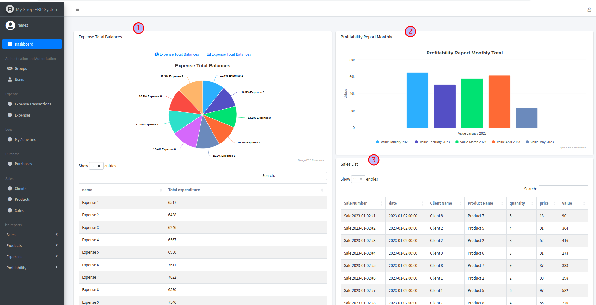

.. image:: https://img.shields.io/pypi/v/django-erp-framework.svg
    :target: https://pypi.org/project/django-erp-framework

.. image:: https://img.shields.io/pypi/pyversions/django-erp-framework.svg
    :target: https://pypi.org/project/django-erp-framework

.. image:: https://img.shields.io/readthedocs/django-erp-framework
    :target: https://django-erp-framework.readthedocs.io/

.. image:: https://img.shields.io/codecov/c/github/RamezIssac/django-erp-framework
    :target: https://codecov.io/gh/RamezIssac/django-erp-framework

Django ERP Framework
====================

A light-weight, effective, Django based framework to create various business applications, resource planing and management systems.

Offers a ready made platform where you can start to create data entry pages and attach various reports to them.

Features
--------

* A Reporting Engine that can generate grouped reports and/or time series and/or crosstab from any model in your apps.
* Charting capabilities to represent the data in the reports.
* Widget system to create dashboards and display bits of the reports results and/or its charts on any page you want.
* Customizable and easily extensible.
* Django Jazzy Tabler admin theme integration ready to use.
* Python 3.10+, Django 5.2 / 6.1

Installation
------------

.. code-block:: console

    $ pip install django-erp-framework
        OR
    $ pip install -e git+https://github.com/RamezIssac/django-erp-framework.git#egg=django-erp-framework@develop

Check out the `getting started <https://django-erp-framework.readthedocs.io/en/latest/getting_started/index.html>`_  on Read The Docs.

Demo
----

You can checkout a demo application `here <https://demo.django-erp.com>`_.

Code is available on `Github <https://github.com/RamezIssac/my-shop>`_.

Documentation
-------------

Available on `Read The Docs <https://django-erp-framework.readthedocs.io/en/latest/>`_

Please Proceed to the tutorial `Create a sales application Part 1 <https://django-erp-framework.readthedocs.io/en/latest/getting_started/index.html>`_

Reporting Engine
----------------

The reporting engine of this framework is released as a separate package `django-slick-reporting <https://pypi.org/project/django-slick-reporting/>`_.

Testing and contribution
------------------------

To run the test suite, first, create and activate a virtual environment. Then
clone the repo, install the test requirements and run the tests::

    # 1. Clone and install requirements
    $ git clone git+git@github.com:RamezIssac/django-erp-framework.git
    $ cd tests
    $ pip install -e ..
    $ pip install -r requirements.txt

    # 2. Set the test database connection details in the environment
    $ export DATABASE_NAME=<database name>
    $ export DATABASE_USER=<database user>
    $ export DATABASE_PASSWORD=<database password if any>

    # 3. Run the tests
    $ ./runtests.py
    # And for Coverage report
    $ coverage run --include=../* runtests.py [-k]
    $ coverage html

Mutation testing
~~~~~~~~~~~~~~~~

Each pull request runs mutation testing on the Python lines it changes and lists the surviving
mutants in the job summary of the ``Mutation`` workflow (report only). To run the same check
locally from the repo root::

    $ pip install "mutmut[patch]==2.5.1"
    $ git diff -U0 origin/develop...HEAD -- 'erp_framework/*.py' ':!erp_framework/**/migrations/*' > pr.patch
    $ mutmut run --paths-to-mutate erp_framework --use-patch-file pr.patch \
        --runner "python tests/runtests.py --noinput --failfast"
    $ mutmut results      # ids of the surviving mutants
    $ mutmut show <id>    # the diff of one mutant

Kill a survivor with a test that asserts the mutated value. When the mutant cannot change behaviour
(an equivalent mutant), mark the line with ``# pragma: no mutate`` and a short reason::

    closest = get_close_matches(word, choices, n=1)  # pragma: no mutate: only closest[0] is read

For more information on contributing, we honor `Django's guidelines <https://docs.djangoproject.com/en/dev/internals/contributing/writing-code/unit-tests/>`_.

